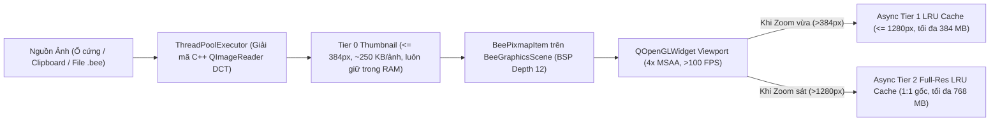

# Kiến Trúc Hệ Thống & Lõi Chống Lag (`ARCHITECTURE.md`)

Tài liệu này mô tả chi tiết kiến trúc bên trong của **Birdboard**, tập trung vào cách hệ thống xử lý mượt mà **1.000 – 5.000+ hình ảnh độ phân giải cao** mà không bị tràn RAM hay tụt FPS.

---

## 1. Sơ Đồ Luồng Kết Xuất & Quản Lý Bộ Nhớ

---

## 2. Sáu Trụ Cột Tối Ưu Hiệu Năng

### 2.1. Giải mã song song đa nhân & C++ DCT Scaling (`beeref/fileio/__init__.py`, `beeref/lod_cache.py`)
- Khi người dùng kéo thả hàng ngàn tấm ảnh vào bảng:
  - Sử dụng `ThreadPoolExecutor` trên toàn bộ luồng CPU với cửa sổ trượt (*bounded in-flight window*) để RAM không bao giờ tăng đột biến.
  - `QImageReader` với `setAutoTransform(True)` xử lý xoay chiều EXIF trực tiếp trong C++ và giải mã khối DCT JPEG ở kích thước thu gọn trước khi lọc mịn `SmoothTransformation`.
  - Đóng handle đọc file ngay lập tức (`reader.setFileName('')`) để không khóa file trên Windows Explorer.
  - Chỉ phát tín hiệu tiến độ về luồng giao diện mỗi `40ms` (~25 Hz) và chèn theo từng lô (`batch_update`), loại bỏ hoàn toàn lệnh ngủ `msleep(10)` và bão sự kiện $O(N^2)$ của BeeRef gốc.

### 2.2. Tháp Mipmap 3 Tầng & Async LRU Eviction (`beeref/lod_cache.py`, `beeref/items.py`)
- Mỗi đối tượng `BeePixmapItem` lưu kích thước gốc thật (`_orig_width`, `_orig_height`) để giữ nguyên hệ tọa độ Crop/Transform, nhưng chỉ giữ thường trực trong RAM bản **Tier 0 (`384px`)**.
- Trong hàm `paint()`:
  - Đo tỷ lệ hiển thị thực trên màn hình bất biến theo góc xoay: `item_to_device = hypot(m11, m12)`.
  - Nếu `screen_max_edge <= 384px` (khi xem toàn cảnh hàng ngàn ảnh): vẽ ngay `thumb_pixmap` trong `0.00ms`.
  - Nếu zoom gần hơn (`Tier 1: <= 1280px` hoặc `Tier 2: Full-Res`): vẽ tạm tầng sẵn có ngay lập tức (không bao giờ chặn luồng UI) đồng thời gửi yêu cầu giải mã ngầm vào `LODCacheManager`. Ngay khi giải mã xong ở luồng nền, ảnh sắc nét tự động cập nhật lên màn hình.
  - Khi tổng dung lượng vượt hạn mức (`384 MB` cho Tier 1, `768 MB` cho Tier 2), các ảnh cũ nằm ngoài vùng đang xem tự động được giải phóng theo thuật toán **Byte-Budget LRU**.

### 2.3. GPU Hardware Viewport (`beeref/view.py`)
- Khung nhìn `BeeGraphicsView` gắn trực tiếp `QOpenGLWidget` với khử răng cưa phần cứng `4x MSAA` và `FullViewportUpdate`, đẩy toàn bộ phép biến đổi ma trận Pan/Zoom/Rotate sang GPU.

### 2.4. Đệm Khung Bao $O(1)$ & Chỉ Mục Không Gian BSP-12 (`beeref/scene.py`)
- Lưu đệm `_cached_all_bounds` và `_cached_sel_bounds` thông qua phép biến đổi C++ `item.sceneTransform().mapRect(...)`. Trong suốt quá trình Zoom/Pan camera, việc truy vấn giới hạn khung cảnh đạt độ phức tạp $O(1)$ tức thời.
- Các hàm kiểm tra vùng chọn (`has_selection`, `has_single_selection`, `has_multi_selection`) dừng ngay sau khi đếm tối đa 2 phần tử thay vì duyệt toàn bộ danh sách hàng ngàn ảnh.

### 2.5. Thuật Toán Xếp Ảnh Lai (`rpack` + `Masonry Column Packer`)
- Với `<= 300` ảnh: Dùng `rpack` (*MaxRects Cython*) tối ưu khít diện tích.
- Với `> 300` ảnh (1.000 – 10.000+ ảnh): Tự động chuyển sang `_pack_large_masonry` sử dụng cấu trúc `heapq` ($O(N \log K)$), xếp 1.200+ ảnh khác tỷ lệ thành khối cân đối trong chưa đầy `5ms`.

### 2.6. Lưu Trữ SQLite `.bee` Tức Thời & Bảng Đệm `lod_thumbs` (`beeref/fileio/sql.py`)
- **Khi lưu file:** Gom toàn bộ câu lệnh SQL vào **1 Transaction duy nhất**, ghi qua file tạm `.birdboard_save_*.bee` rồi hoán đổi nguyên tử (`os.replace`) để an toàn tuyệt đối ngay cả khi lưu đè chính file đang mở.
- **Tái sử dụng luồng byte nén gốc:** Nếu ảnh gốc là JPG/PNG không xoay EXIF, ghi thẳng byte gốc vào bảng `sqlar` mà không cần giải mã/nén lại (tránh suy giảm chất lượng và nhanh hơn gấp nhiều lần).
- **Bảng phụ `lod_thumbs`:** Lưu sẵn ảnh thu nhỏ ~15 KB cho mỗi mục (vẫn tương thích ngược 100% với chuẩn `.bee`). Khi mở lại dự án hàng ngàn ảnh, Birdboard chỉ nạp bảng `lod_thumbs` trong ~1 giây và giữ toàn bộ ảnh 4K gốc nằm yên trên ổ đĩa, chỉ đọc lên khi người dùng zoom sát vào ảnh cụ thể.
