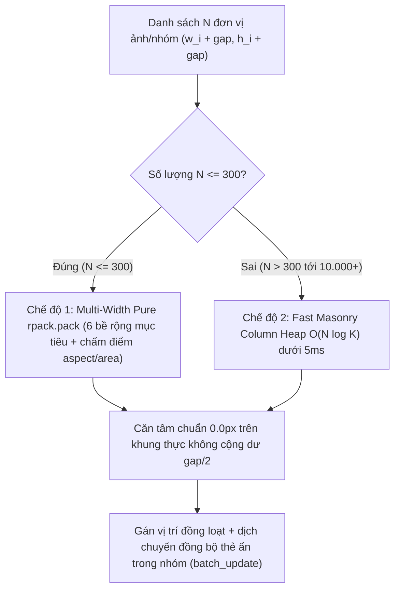

# Hướng Dẫn Chi Tiết & Giải Phẫu Thuật Toán: Sắp Xếp Khối Vuông (`Arrange -> Optimal`) & Khoảng Cách Hình (`Arrange Gap`)

Tài liệu này ghi chú đầy đủ cả **hướng dẫn sử dụng thực tế** lẫn **công thức toán học & mã nguồn thuật toán** đứng sau tính năng gom hàng loạt hình ảnh khác kích thước thành một khối vuông/chữ nhật đặc khít (`Arrange -> Optimal`) kèm điều chỉnh khoảng cách khe hở (`Arrange Gap`) trong **Birdboard**.


---

## Phần 1 — Hướng Dẫn Sử Dụng Thực Tế

### 1.1. Cách gom hình thành khối vuông tối ưu (`Arrange -> Optimal`)
1. **Chọn các hình cần sắp xếp:**
   - Kéo chuột trái bao quanh nhóm hình (hoặc bấm `Ctrl + A` để chọn toàn bộ bảng).
2. **Kích hoạt xếp khối tối ưu:**
   - **Cách 1 (Phím tắt nhanh):** Bấm **`Shift + O`**.
   - **Cách 2 (Menu chuột phải):** Click chuột phải → **`Arrange` → `Optimal`**.
3. **Kết quả:**
   - Dù các bức ảnh ban đầu có tỷ lệ ngang, dọc, to, nhỏ hay đã cắt cúp (`Crop`) / xoay nghiêng khác nhau, thuật toán sẽ tự động tính toán diện tích tổng và ghép khít toàn bộ vào **một khung hình vuông cân đối** lấy tâm tại đúng vị trí trung tâm của nhóm ảnh đang chọn.
   - Khi bạn kéo thả hàng loạt ảnh mới từ máy tính vào bảng, Birdboard cũng tự động chạy chế độ `Optimal` theo mặc định (có thể đổi trong `Settings -> Images & Items -> Default Arrange Method`).

### 1.2. Hai cách chọn khoảng cách khe hở giữa các hình (`Arrange Gap`)

Khoảng cách `Arrange Gap` (tính bằng đơn vị `px` trong không gian Canvas, phạm vi `0 – 200 px`) quyết định khe hở thoáng đều giữa mọi bức ảnh khi chạy `Optimal`, `Horizontal`, `Vertical` hoặc `Square`:

- **Cách 1 — Chỉnh trực quan xem trước theo thời gian thực (`Live Preview` — Khuyên dùng):**
  1. Chọn nhóm ảnh đang muốn căn chỉnh khoảng cách.
  2. Bấm phím tắt **`Shift + G`** (hoặc click chuột phải → **`Arrange` → `Arrange Gap...`**).
  3. Kéo thanh trượt `0 – 200 px` (hoặc bấm các nút mốc nhanh `0`, `4`, `8`, `12`, `16`, `24`, `32 px`):
     - Khối ảnh trên màn hình sẽ **co giãn khoảng cách trực tiếp ngay khi bạn kéo chuột** để chọn độ thoáng vừa mắt nhất.
     - Bấm **OK** để chốt bố cục & lưu khoảng cách cho các lần sau (hỗ trợ `Ctrl + Z` hoàn tác gọn trong 1 bước), hoặc bấm **Cancel** để trả về vị trí cũ.
- **Cách 2 — Thiết lập cố định trong bảng Cài đặt (`Settings`):**
  - Click chuột phải → **`Settings` → `Settings` → Tab `Images & Items` → mục `Arrange Gap`** → nhập số pixel mong muốn (`0` = xếp sát khít không khe hở; `8–16` = có khe viền thoáng như ảnh minh họa ở đầu bài).

> **Mẹo kết hợp cực mạnh:** Nếu các bức ảnh tải về có kích thước chênh lệch quá lớn (ảnh 4000px nằm cạnh ảnh 300px), bạn hãy bấm **`Shift + S`** (`Normalize -> Size` — cân bằng diện tích) hoặc **`Shift + H`** (`Normalize -> Height` — cân bằng chiều cao) **trước**, sau đó bấm **`Shift + O`** (`Arrange -> Optimal`). Khối vuông tạo ra sẽ đều tăm tắp như gạch lát!

---

## Phần 2 — Giải Phẫu Thuật Toán Sắp Xếp Khối Vuông (Cập nhật `v1.1.0` — Dành Cho Developer & AI Agent)

> **Liên kết quan trọng (`v1.1.0`):** Động cơ `pack_optimal_sizes()` dưới đây hiện được **dùng chung hợp nhất** cho cả lệnh sắp xếp ngoài bảng (`Shift + O`) lẫn chế độ bung lưới xem **Nhóm Xếp Chồng (`Spread Optimal`)**. Xem trọn bộ quy tắc Nhóm Xếp Chồng và tương tác tại [STACK_GROUP_AND_ARRANGEMENT_GUIDE.md](STACK_GROUP_AND_ARRANGEMENT_GUIDE.md).

Mã nguồn thực thi nằm tại:
- `beeref/scene.py` → hàm `pack_optimal_sizes()`, `_pack_large_masonry()`, `compute_optimal_positions()`, `_collapse_stack_units_for_arrange()`, `_arrange_unit_scene_rect()`, và `arrange_optimal()`
- `beeref/stack_manager.py` → hàm `compute_spread_grid()` (gọi thẳng `scene.pack_optimal_sizes()`)
- `beeref/commands.py` → class `ArrangeItems` (kèm `_move_collapsed_companions()` cho Nhóm Xếp Chồng)
- `beeref/widgets/__init__.py` → class `ArrangeGapDialog`

### 2.1. Bước 1: Rút Gọn Đơn Vị Nhóm (`Stack-Aware`), Đo Khung Bao Thực Tế & Cộng Biên `gap`
1. **Rút gọn Nhóm Xếp Chồng thu gọn thành 1 đơn vị (`v1.1.0`):**
   - Trước khi tính tọa độ, `_collapse_stack_units_for_arrange(items)` gom tất cả các thẻ thuộc cùng một Nhóm đang thu gọn về **duy nhất 1 đại diện (`Cover`)**, tránh việc `Shift + O` làm vỡ bung các tấm ảnh underlay ra khỏi xấp.
2. **Đo khung bao trục tọa độ Scene thực tế (`Axis-Aligned Scene Bounding Box`):**
   - Với ảnh đơn (có thể đã `scale`, `rotate`, `flip`, `crop`): đo `item.bounding_rect_unselected()`.
   - Với Cover của một Nhóm đang thu gọn: `_arrange_unit_scene_rect(item)` đo **toàn bộ diện tích xấp ảnh đang xòe** thông qua `item._collapsed_pile_local_rect()` để các nhóm sau khi xếp không bị chồng lấn mép ảnh underlay lên nhau:

```python
if hasattr(item, '_is_collapsed_stack_cover') and item._is_collapsed_stack_cover():
    rect = item.sceneTransform().mapRect(item._collapsed_pile_local_rect())
else:
    rect = item.sceneTransform().mapRect(item.bounding_rect_unselected())
```

3. **Cộng biên khoảng cách `gap`:**
   $$w_i' = \max(1, \text{round}(\text{rect}_i.\text{width} + \text{gap})), \quad h_i' = \max(1, \text{round}(\text{rect}_i.\text{height} + \text{gap}))$$

*(Nhờ cộng `gap` trực tiếp vào kích thước hộp bao khi đưa vào bộ xếp hình, mỗi bức ảnh/nhóm tự động giữ khoảng cách đúng bằng `gap` với phần tử bên phải và bên dưới mà không cần tính lại va chạm).*

---

### 2.2. Bước 2: Kiến trúc Thuật toán Xếp hình Lai 2 Tầng (`Hybrid 2-Tier Bin Packing`)

Bài toán *2D Rectangle Bin Packing* (xếp $N$ hình chữ nhật bất kỳ vào một hình vuông có diện tích nhỏ nhất không chồng lấn) là bài toán **NP-Hard**. Nếu chỉ dùng 1 thuật toán duy nhất:
- Dùng bộ giải chính xác (*MaxRects / Guillotine* trong `rpack`) thì dưới 300 hình cực đẹp, nhưng khi lên tới **1.000 – 3.000 hình** độ phức tạp $O(N^{2.5})$ sẽ làm đơ cứng phần mềm hàng chục giây.
- Do đó, **Birdboard** thiết kế cơ chế chuyển tầng tự động tại ngưỡng $N = 300$:



#### Chế độ 1 — Dưới hoặc bằng 300 đơn vị: Multi-Width Pure `rpack.pack` (`v1.1.0`)
Thay vì chỉ thử 1 cạnh hình vuông đơn lẻ (có thể sinh ra cột cao gầy `2 × 7` với ảnh đủ tỷ lệ hoặc rớt lẻ 1 ảnh xuống hàng dưới), `pack_optimal_sizes()` đánh giá đồng thời **6 bề rộng khởi điểm (`base_widths`)**:
1. $w_{\text{grid}} = \lceil \text{round}(\sqrt{N}) \cdot \bar{w} \cdot 1.005 \rceil$ *(khóa lưới vuông đẹp như `4 × 4` cho 16 ảnh cùng tỷ lệ)*
2. $w_{\text{cols\_ceil}} = \lceil \lceil \sqrt{N} \rceil \cdot \bar{w} \cdot 1.005 \rceil$
3. $w_{\text{area\_sq}} = \lceil \sqrt{A_{\min}} \cdot 1.04 \rceil$
4. $\lceil \sqrt{A_{\min}} \cdot 1.18 \rceil$ và $\lceil \sqrt{A_{\min}} \cdot 1.32 \rceil$ *(cho tập ảnh pha trộn tỷ lệ ngang/dọc cực đoan)*
5. $w_{\text{area\_ratio}} = \lceil \sqrt{A_{\min} \cdot \bar{w} / \bar{h}} \cdot 1.03 \rceil$

Với mỗi bề rộng $w_0$:
- Áp trần chiều cao chặt $h_{\text{limit}} = \max(\max_i h_i',\ \lceil (A_{\min} / w_{\text{try}}) \cdot 1.28 \rceil)$ và chạy tối đa **10 bước nới biên an toàn** ($h_{\text{limit}} \leftarrow \lceil 1.10 \cdot h_{\text{limit}} \rceil$, $w_{\text{try}} \leftarrow \lceil 1.04 \cdot w_{\text{try}} \rceil$) nếu `rpack.pack()` báo `PackingImpossibleError`.
- Chấm điểm tất cả phương án thành công theo diện tích kết hợp phạt lệch tỷ lệ vuông:
  $$\text{score}(b_w, b_h) = (b_w \cdot b_h) \times \left(1 + 0.22 \cdot \left|\ln\left(\frac{b_w}{b_h}\right)\right|\right)$$
- Chọn phương án đạt `score` nhỏ nhất: đạt **`4 × 4` chuẩn xác** trên 16 ảnh chân dung và tỷ lệ **`bw / bh ≈ 1.06`** trên tập 14 ảnh pha trộn ngang/dọc.

#### Chế độ 2 — Trên 300 đơn vị (1.000 – 10.000+ ảnh): Masonry Column Min-Heap ($O(N \log K)$)
Khi nạp hàng ngàn bức ảnh, hàm `_pack_large_masonry(sizes)` thực hiện trong **dưới `5 ms`**:
1. Tính tổng diện tích $A_{\min}$ và bề rộng trung bình $\bar{w} = \frac{1}{N}\sum w_i'$.
2. Xác định số cột mục tiêu để tổng thể gần với **khối vuông** nhất:
   $$K = \max\left(2,\ \text{round}\left(\frac{\sqrt{1.05 \cdot A_{\min}}}{\bar{w}}\right)\right)$$
3. Khởi tạo hàng đợi ưu tiên `min-heap` gồm $K$ cột với chiều cao ban đầu bằng `0`: `[(0, col_idx) for col_idx in range(K)]`.
4. Duyệt từng ảnh $i$: luôn lấy ra cột đang có chiều cao tích lũy **thấp nhất** từ đỉnh `heap` ($O(\log K)$), xếp ảnh $i$ vào cột đó và cập nhật lại chiều cao cột `cur_h + h_i'` vào `heap`.
5. Quét qua $K$ cột lần cuối để tính bề rộng thực của từng cột ($\text{col\_w}_c = \max_{i \in c} w_i'$), căn giữa ngang từng ảnh trong cột của nó và cộng dồn tọa độ $X$. Kết quả tạo ra một khối vuông dạng lưới gạch (*Masonry*) cân đối tức thì.

---

### 2.3. Bước 3: Bù Gốc Xoay/Crop, Khử Trôi `gap/2` & Di Chuyển Đồng Bộ Nhóm (`ArrangeItems`)

Một lỗi kinh điển khi viết hàm xếp ảnh trên Canvas là gọi thẳng `item.setPos(target_pos)`, khiến những tấm ảnh đã bị **xoay góc** hoặc **cắt Crop** bị văng lệch khỏi ô chứa, hoặc làm xấp ảnh Nhóm Xếp Chồng bị rớt lại các tấm lót phía sau!

Trong `beeref/commands.py` (`ArrangeItems.redo` / `undo`) và `beeref/scene.py` (`compute_optimal_positions`), Birdboard v1.1.0 xử lý trọn vẹn 3 bước:
1. **Khử trôi `gap / 2`:** Tâm khối sau khi đóng gói được tính từ biên thực `unpadded_rects` ($\max_x = \max(p_x + w_{\text{thực}})$, $\max_y = \max(p_y + h_{\text{thực}})$) rồi dịch bằng `diff = selection_center - packed_center`, giữ độ lệch tâm **`0.0 px`**.
2. **Bù độ lệch gốc biến đổi:** Tính hiệu số giữa gốc `(0, 0)` của item và góc trái-trên của khung đơn vị (`_collapsed_pile_local_rect()` nếu là Cover nhóm thu gọn, hoặc `bounding_rect_unselected()` nếu là ảnh rời).
3. **Di chuyển đồng bộ toàn bộ thành viên nhóm (`_move_collapsed_companions`):** Hủy mọi animation đang bay (`cancel_flights_for`), dịch chuyển toàn bộ thẻ underlay và thẻ lớp sâu đang ẩn cùng vector `new_p - old_p`, cập nhật `stack_center` và đồng bộ `StackOverlayLabelItem`:

```python
with self.scene.batch_update():
    for item, pos in zip(self.items, self.positions):
        old_p = QtCore.QPointF(item.pos())
        self.old_positions.append(old_p)
        orig_topleft = item.mapToScene(QtCore.QPointF(0, 0))
        unit_local = (
            item._collapsed_pile_local_rect()
            if (hasattr(item, '_is_collapsed_stack_cover') and item._is_collapsed_stack_cover())
            else item.bounding_rect_unselected()
        )
        rect_topleft = item.sceneTransform().mapRect(unit_local).topLeft()
        new_p = pos + orig_topleft - rect_topleft
        item.setPos(new_p)
        self._move_collapsed_companions(item, new_p - old_p)
```
