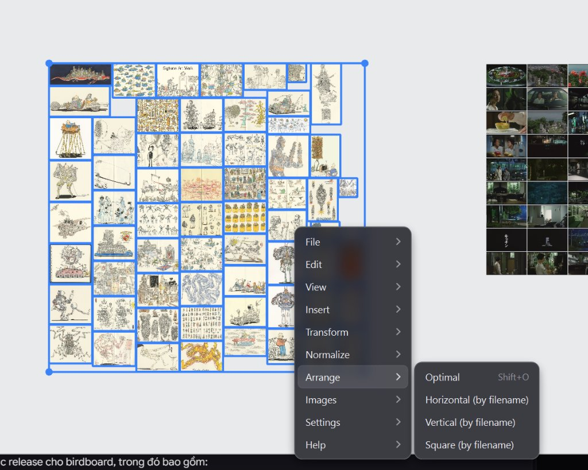
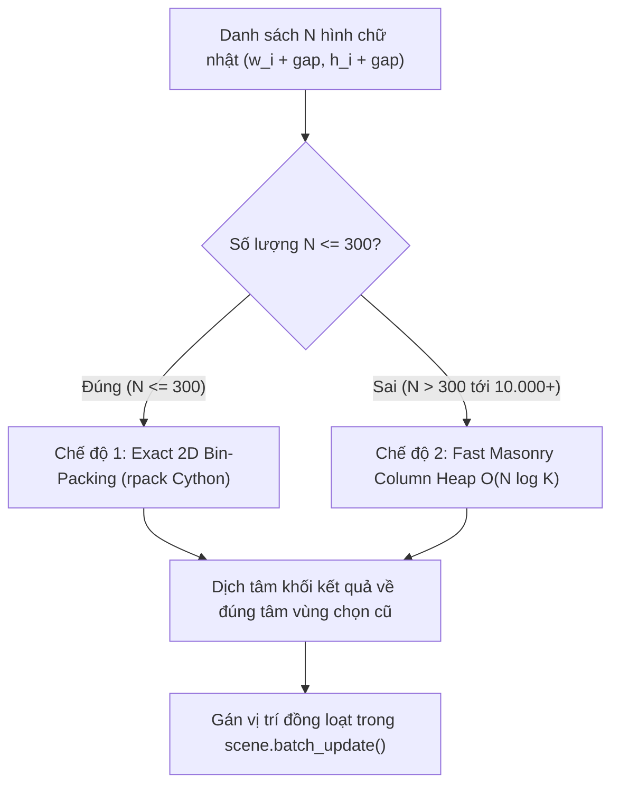

# Hướng Dẫn Chi Tiết & Giải Phẫu Thuật Toán: Sắp Xếp Khối Vuông (`Arrange -> Optimal`) & Khoảng Cách Hình (`Arrange Gap`)

Tài liệu này ghi chú đầy đủ cả **hướng dẫn sử dụng thực tế** lẫn **công thức toán học & mã nguồn thuật toán** đứng sau tính năng gom hàng loạt hình ảnh khác kích thước thành một khối vuông/chữ nhật đặc khít (`Arrange -> Optimal`) kèm điều chỉnh khoảng cách khe hở (`Arrange Gap`) trong **Birdboard**.



---

## Phần 1 — Hướng Dẫn Sử Dụng Thực Tế

### 1.1. Cách gom hình thành khối vuông tối ưu (`Arrange -> Optimal`)
1. **Chọn các hình cần sắp xếp:**
   - Kéo chuột trái bao quanh nhóm hình (hoặc bấm `Ctrl + A` để chọn toàn bộ bảng).
2. **Kích hoạt xếp khối tối ưu:**
   - **Cách 1 (Phím tắt nhanh):** Bấm **`Shift + O`**.
   - **Cách 2 (Menu chuột phải):** Click chuột phải → **`Arrange` → `Optimal`**.
3. **Kết quả:**
   - Dù các bức ảnh ban đầu có tỷ lệ ngang, dọc, to, nhỏ hay đã cắt cúp (`Crop`) / xoay nghiêng khác nhau, thuật toán sẽ tự động tính toán diện tích tổng và ghép khít toàn bộ vào **một khung hình vuông cân đối** lấy tâm tại đúng vị trí trung tâm của nhóm ảnh đang chọn.
   - Khi bạn kéo thả hàng loạt ảnh mới từ máy tính vào bảng, Birdboard cũng tự động chạy chế độ `Optimal` theo mặc định (có thể đổi trong `Settings -> Images & Items -> Default Arrange Method`).

### 1.2. Hai cách chọn khoảng cách khe hở giữa các hình (`Arrange Gap`)

Khoảng cách `Arrange Gap` (tính bằng đơn vị `px` trong không gian Canvas, phạm vi `0 – 200 px`) quyết định khe hở thoáng đều giữa mọi bức ảnh khi chạy `Optimal`, `Horizontal`, `Vertical` hoặc `Square`:

- **Cách 1 — Chỉnh trực quan xem trước theo thời gian thực (`Live Preview` — Khuyên dùng):**
  1. Chọn nhóm ảnh đang muốn căn chỉnh khoảng cách.
  2. Bấm phím tắt **`Shift + G`** (hoặc click chuột phải → **`Arrange` → `Arrange Gap...`**).
  3. Kéo thanh trượt `0 – 200 px` (hoặc bấm các nút mốc nhanh `0`, `4`, `8`, `12`, `16`, `24`, `32 px`):
     - Khối ảnh trên màn hình sẽ **co giãn khoảng cách trực tiếp ngay khi bạn kéo chuột** để chọn độ thoáng vừa mắt nhất.
     - Bấm **OK** để chốt bố cục & lưu khoảng cách cho các lần sau (hỗ trợ `Ctrl + Z` hoàn tác gọn trong 1 bước), hoặc bấm **Cancel** để trả về vị trí cũ.
- **Cách 2 — Thiết lập cố định trong bảng Cài đặt (`Settings`):**
  - Click chuột phải → **`Settings` → `Settings` → Tab `Images & Items` → mục `Arrange Gap`** → nhập số pixel mong muốn (`0` = xếp sát khít không khe hở; `8–16` = có khe viền thoáng như ảnh minh họa ở đầu bài).

> **Mẹo kết hợp cực mạnh:** Nếu các bức ảnh tải về có kích thước chênh lệch quá lớn (ảnh 4000px nằm cạnh ảnh 300px), bạn hãy bấm **`Shift + S`** (`Normalize -> Size` — cân bằng diện tích) hoặc **`Shift + H`** (`Normalize -> Height` — cân bằng chiều cao) **trước**, sau đó bấm **`Shift + O`** (`Arrange -> Optimal`). Khối vuông tạo ra sẽ đều tăm tắp như gạch lát!

---

## Phần 2 — Giải Phẫu Thuật Toán Sắp Xếp Khối Vuông (Dành Cho Developer & AI Agent)

Mã nguồn thực thi nằm tại:
- `beeref/scene.py` → hàm `compute_optimal_positions()`, `arrange_optimal()`, và `_pack_large_masonry()`
- `beeref/commands.py` → class `ArrangeItems`
- `beeref/widgets/__init__.py` → class `ArrangeGapDialog`

### 2.1. Bước 1: Đo khung bao thực tế và cộng biên khoảng cách `gap`
Mỗi bức ảnh trên Canvas có thể đã bị `scale`, `rotate`, `flip` hoặc `crop`. Do đó tuyệt đối không lấy kích thước ảnh gốc mà phải lấy **khung bao trục tọa độ Scene thực tế (`Axis-Aligned Scene Bounding Box`)** thông qua ma trận biến đổi C++:

```python
rect = item.sceneTransform().mapRect(item.bounding_rect_unselected())
```

Sau đó cộng thêm giá trị khoảng cách `gap` vào cả chiều rộng lẫn chiều cao của từng hộp chữ nhật thứ $i$:
$$w_i' = \max(1, \text{round}(\text{rect}_i.\text{width} + \text{gap})), \quad h_i' = \max(1, \text{round}(\text{rect}_i.\text{height} + \text{gap}))$$

*(Nhờ cộng `gap` trực tiếp vào kích thước hộp bao khi đưa vào bộ xếp hình, mỗi bức ảnh tự động giữ khoảng cách đúng bằng `gap` với ảnh bên phải và ảnh bên dưới mà không cần tính lại va chạm).*

---

### 2.2. Bước 2: Kiến trúc Thuật toán Xếp hình Lai 2 Tầng (`Hybrid 2-Tier Bin Packing`)

Bài toán *2D Rectangle Bin Packing* (xếp $N$ hình chữ nhật bất kỳ vào một hình vuông có diện tích nhỏ nhất không chồng lấn) là bài toán **NP-Hard**. Nếu chỉ dùng 1 thuật toán duy nhất:
- Dùng bộ giải chính xác (*MaxRects / Guillotine* trong `rpack`) thì dưới 300 hình cực đẹp, nhưng khi lên tới **1.000 – 3.000 hình** độ phức tạp $O(N^{2.5})$ sẽ làm đơ cứng phần mềm hàng chục giây.
- Do đó, **Birdboard** thiết kế cơ chế chuyển tầng tự động tại ngưỡng $N = 300$:



#### Chế độ 1 — Dưới hoặc bằng 300 hình: Exact Bin-Packing với `rectangle-packer` (`rpack`)
1. **Ước lượng cạnh hình vuông khởi điểm $W_0$:**
   Tổng diện tích lý tưởng tối thiểu là $A_{\min} = \sum_{i=1}^{N} w_i' \cdot h_i'$. Cạnh hình vuông khởi điểm được lấy bằng:
   $$W_0 = \max\left(\max_i w_i',\ \max_i h_i',\ \lceil \sqrt{A_{\min}} \times 1.06 \rceil\right)$$
   *(Hệ số bù khe hở `1.06` giúp 90% trường hợp xếp thành công ngay ở lần thử đầu tiên mà không tốn vòng lặp thử sai).*
2. **Vòng lặp nới biên an toàn:**
   Gọi `rpack.pack(sizes, max_width=W, max_height=W)`. Nếu các hình có tỷ lệ quá dị biệt khiến không nhét vừa hộp $W \times W$ (`PackingImpossibleError`), tăng cạnh hộp lên $20\%$ ($W \leftarrow \lceil 1.2 \times W \rceil$) và thử lại cho tới khi thành công.

#### Chế độ 2 — Trên 300 hình (1.000 – 10.000+ hình): Masonry Column Min-Heap ($O(N \log K)$)
Khi nạp hàng ngàn bức ảnh, hàm `_pack_large_masonry(sizes)` thực hiện trong **dưới `5 ms`**:
1. Tính tổng diện tích $A_{\min}$ và bề rộng trung bình $\bar{w} = \frac{1}{N}\sum w_i'$.
2. Xác định số cột mục tiêu để tổng thể gần với **khối vuông** nhất:
   $$K = \max\left(2,\ \text{round}\left(\frac{\sqrt{1.05 \cdot A_{\min}}}{\bar{w}}\right)\right)$$
3. Khởi tạo hàng đợi ưu tiên `min-heap` gồm $K$ cột với chiều cao ban đầu bằng `0`: `[(0, col_idx) for col_idx in range(K)]`.
4. Duyệt từng ảnh $i$: luôn lấy ra cột đang có chiều cao tích lũy **thấp nhất** từ đỉnh `heap` ($O(\log K)$), xếp ảnh $i$ vào cột đó và cập nhật lại chiều cao cột `cur_h + h_i'` vào `heap`.
5. Quét qua $K$ cột lần cuối để tính bề rộng thực của từng cột ($\text{col\_w}_c = \max_{i \in c} w_i'$), căn giữa ngang từng ảnh trong cột của nó và cộng dồn tọa độ $X$. Kết quả tạo ra một khối vuông dạng lưới gạch (*Masonry*) cân đối tức thì.

---

### 2.3. Bước 3: Bù trừ Gốc Tọa Độ Xoay/Crop & Giữ Tâm Vùng Chọn (`ArrangeItems`)

Một lỗi kinh điển khi viết hàm xếp ảnh trên Canvas là gọi thẳng `item.setPos(target_pos)`, khiến những tấm ảnh đã bị **xoay góc** hoặc **cắt Crop** bị văng lệch khỏi ô chứa!

Trong `beeref/commands.py` (`ArrangeItems.redo`), Birdboard xử lý chính xác bằng hiệu số vector giữa gốc nội tại `(0, 0)` của Item và góc trái-trên thực tế của khung bao sau biến đổi:

```python
with self.scene.batch_update():
    for item, pos in zip(self.items, self.positions):
        self.old_positions.append(item.pos())
        orig_topleft = item.mapToScene(QtCore.QPointF(0, 0))
        rect_topleft = item.sceneTransform().mapRect(
            item.bounding_rect_unselected()).topLeft()
        # Bù độ lệch do Crop / Rotate / Flip để khung bao khớp khít 100% vào ô pos:
        item.setPos(pos + orig_topleft - rect_topleft)
```

Đồng thời toàn bộ khối được dịch chuyển một vector `diff = selection_center - QtCore.QPointF(bbox_w / 2, bbox_h / 2)` để khối vuông sau khi xếp luôn nằm ngay ngắn đúng tại tâm nhìn hiện tại của người dùng.
