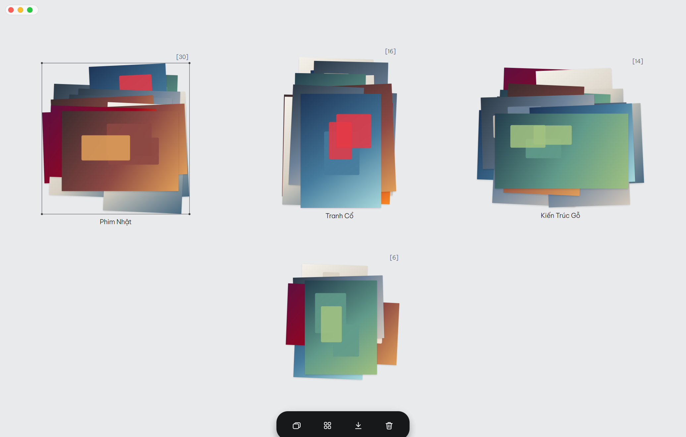
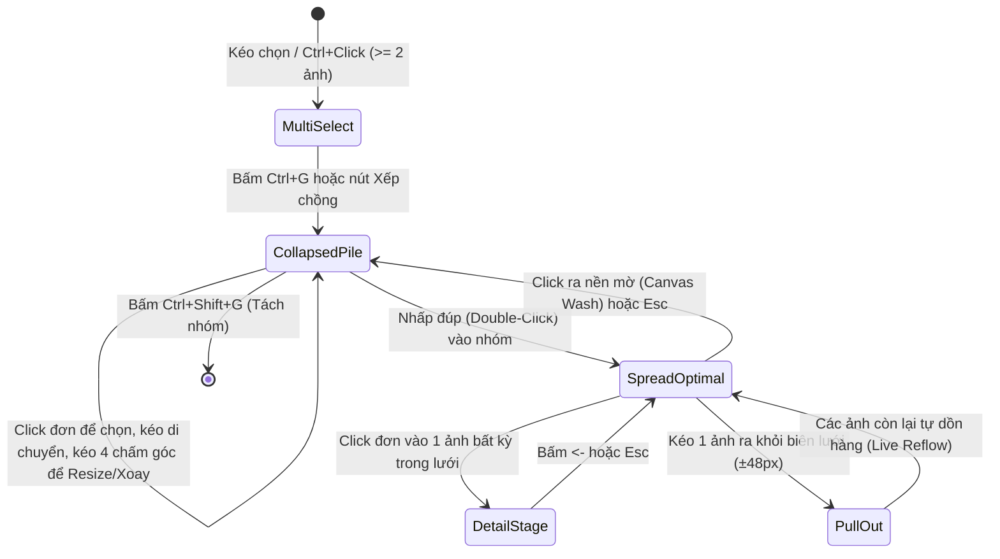
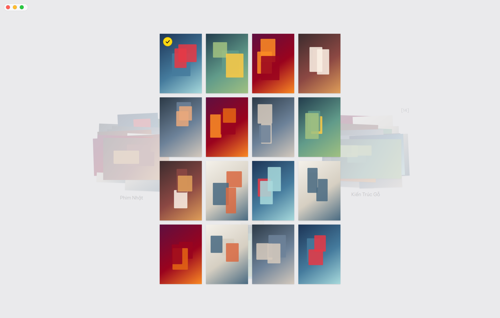
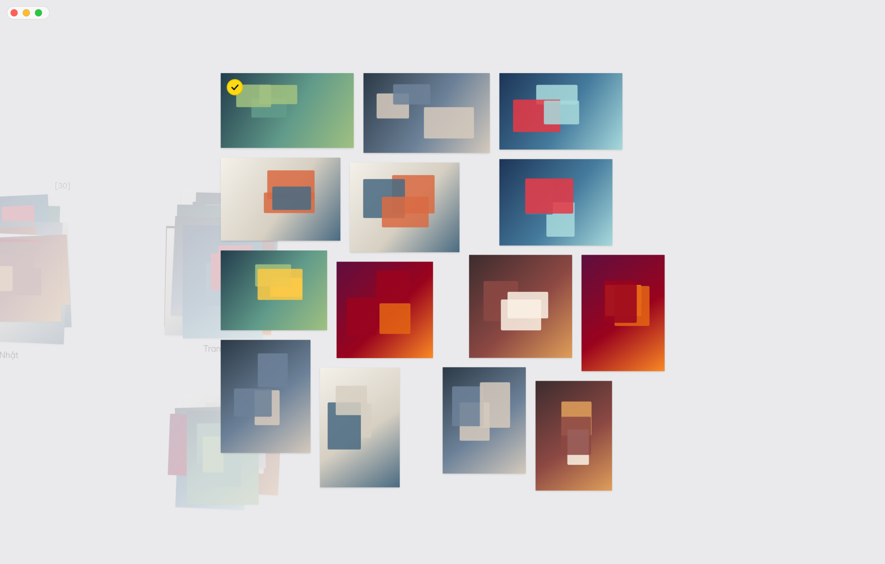
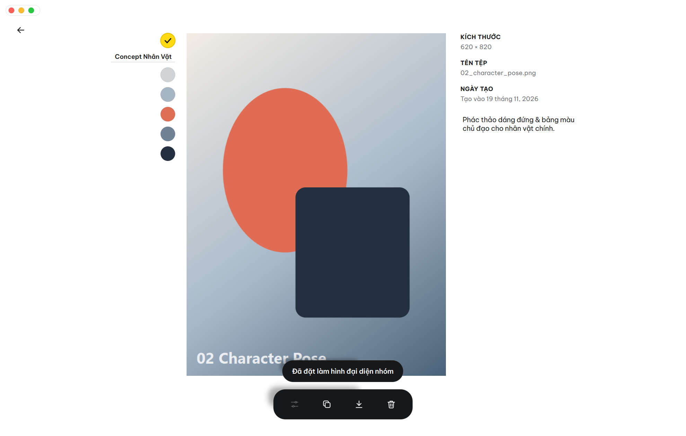
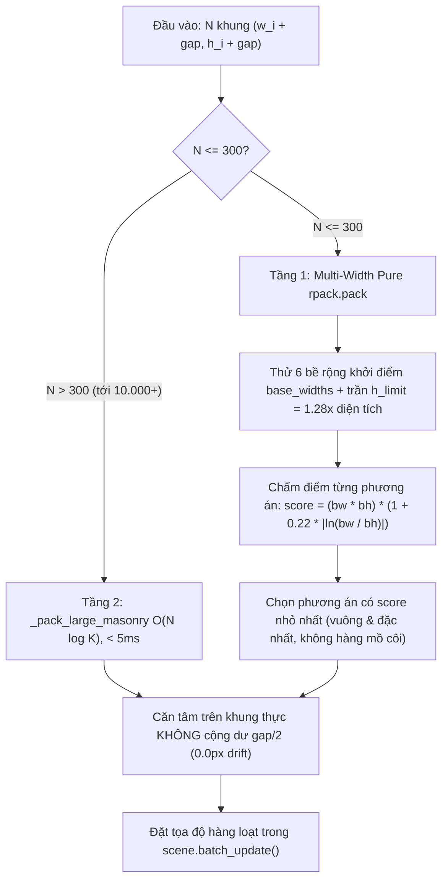

# Hướng Dẫn Toàn Tập & Quy Tắc Kỹ Thuật: Nhóm Xếp Chồng (`Stack Group`), `Detail Stage View` & Sắp Xếp Hình (`Optimal Packing`)

Tài liệu này là bộ hướng dẫn chính thức của **Birdboard v1.1.0**, ghi chú đầy đủ cả **cách sử dụng thực tế cho người dùng** lẫn **toàn bộ các quy tắc nội tại, cơ chế vật lý, công thức toán học và bất biến kỹ thuật** đứng sau 3 trụ cột cốt lõi:
1. **Gom & Tách Nhóm Xếp Chồng (`Stack Group`)**
2. **Màn hình Xem Chi Tiết (`Detail Stage View`) & Hệ Tương Tác Chuột/Khung Chọn**
3. **Thuật Toán Sắp Xếp Hình (`Arrange Optimal` & `Spread Optimal` thuần `rpack`)**

---

## Phần 1 — Hướng Dẫn Sử Dụng Nhanh (Dành Cho Người Dùng)

### 1.1. Vòng Đời 5 Trạng Thái Của Một Nhóm Xếp Chồng

### 1.2. Cách Gom Nhóm (`Group`) & Tách Nhóm (`Unstack`)
- **Gom nhóm mới (`Ctrl + G`):**
  1. Chọn từ **2 hình ảnh trở lên** (kéo khung chọn từ nền trống hoặc từ các **khe hẹp giữa ảnh**, hoặc giữ `Ctrl + Click`).
  2. Khi có `>= 2` ảnh đang chọn, **Thanh Công Cụ Đảo Màu (`Contextual Toolbar`)** sẽ trồi lên ở đáy màn hình.
  3. Bấm phím tắt **`Ctrl + G`** (hoặc bấm nút **Xếp chồng** trên thanh đáy, hoặc `Click chuột phải → Arrange → Group / Stack Selected`).
  4. Toàn bộ ảnh thu gom về đúng tâm vùng chọn thành một **xấp bưu thiếp xếp chồng vật lý**:
     - Góc phải trên hiển thị **số lượng ảnh trong nhóm dạng `[N]`** nét mỏng thanh thoát (`Be Vietnam Pro Light 11px`).
     - Phía bên dưới hiển thị **Tên nhóm** (nếu đã đặt) lơ lửng như tên thư mục (`Be Vietnam Pro Light 13px`).
- **Gom nhiều nhóm cũ hoặc gộp thêm ảnh rời vào nhóm:**
  - Chọn nhóm cũ + ảnh rời mới (hoặc chọn nhiều nhóm cùng lúc) rồi bấm **`Ctrl + G`**. Birdboard tự động kéo theo **cả những ảnh lớp sâu đang ẩn** bên trong nhóm cũ để gộp đủ 100%, không bao giờ bỏ sót ảnh.
- **Tách nhóm (`Ctrl + Shift + G`):**
  - Chọn 1 hoặc nhiều nhóm (hoặc đang bung lưới nhóm) rồi bấm **`Ctrl + Shift + G`** (hoặc bấm nút **Tách chồng** trên thanh đáy). Toàn bộ ảnh tách về trạng thái ảnh rời, tự động dàn lưới đẹp mắt quanh tâm cũ và giữ nguyên tỷ lệ kích thước gốc.

### 1.3. Thao Tác Với Nhóm Đang Thu Gọn (`Collapsed Pile`)
- **Chọn, Di chuyển & Resize nguyên khối:**
  - **`Click đơn`:** Chọn trọn cả nhóm với **khung chọn mảnh `1px` màu xám đen** (`#3A3C42` ở Light Mode / `#A8AAB2` ở Dark Mode) và **4 chấm tròn góc `4px`**.
  - **Kéo thân nhóm:** Di chuyển đồng bộ cả Hình đại diện, tối đa 12 thẻ underlay hiển thị và toàn bộ thẻ lớp sâu đang ẩn phía sau.
  - **Kéo 4 chấm tròn góc:** Phóng to / thu nhỏ đồng bộ cả nhóm (có bảo vệ giới hạn thu nhỏ tối thiểu `>= 4%`, không bao giờ bị mất hình hoặc vỡ tỷ lệ khi `Ctrl + Z`).
  - **Xoay nhóm:** Đưa chuột ra ngoài 4 chấm góc để xoay (giữ `Ctrl` hoặc `Shift` để bắt góc mỗi `15°`).
- **Cộng / Trừ chọn nguyên nhóm (`Ctrl + Click`):**
  - Giữ `Ctrl + Click` vào một nhóm thu gọn sẽ **bật hoặc tắt chọn trọn bộ nhóm đó** như một đơn vị duy nhất.
- **Chọn toàn bảng (`Ctrl + A`):**
  - Chỉ chọn các hình đang hiển thị (bỏ qua thẻ ẩn lớp sâu bên trong nhóm) nên khung bao tổng và các lệnh xử lý hàng loạt luôn chính xác.
- **Phản hồi di chuột nhẹ (`Hover Micro-Bounce`):**
  - Khi rà chuột qua bất kỳ ảnh rời hoặc nhóm xếp chồng nào, thẻ ảnh sẽ **khẽ nhún nổi lên nhẹ nhàng** để báo vị trí con trỏ. Khi bạn kéo chuột, pan hoặc zoom, hiệu ứng tự tạm ngưng để ưu tiên độ mượt 100%.

### 1.4. Bung Lưới Xem Nhóm (`Spread Optimal`) & Kéo Tách Ảnh (`Pull-Out`)

| Bung lưới 16 ảnh cùng tỷ lệ dọc → Lưới `4 × 4` cân đối | Bung lưới 14 ảnh đủ tỷ lệ ngang/dọc → Khối vuông `rpack` |
| :---: | :---: |
|  |  |

- **Mở lưới xem nhóm:** **`Nhấp đúp (Double-Click)`** vào nhóm xếp chồng trên bảng chính *(hoặc chọn nhóm rồi bấm nút **Bung lưới** trên thanh công cụ đáy)*.
  - Nền bảng phía sau phủ lớp màn mờ dịu (`Canvas Wash`, độ mờ `80%`) giúp tập trung tuyệt đối vào nội dung bên trong nhóm.
  - Toàn bộ ảnh trong nhóm bay bung ra theo **cùng thuật toán xếp khối vuông tối ưu `Optimal` (`Shift + O`)**, không còn hiện tượng xếp hàng lẻ loi hay kéo dài thành cột dọc.
  - **Hình đại diện (`Cover`)** luôn đứng tại ô đầu tiên `#0` với **huy hiệu dấu tích vàng `#FFDA12`** ở góc trái trên.
- **Đổi nhanh Hình đại diện ngay trong lưới Spread:**
  - Di chuột lên bất kỳ bức ảnh nào trong lưới → bấm thẳng vào **vòng tròn dấu tích ở góc trái trên ảnh** → ảnh đó lập tức trở thành Hình đại diện mới, tự chuyển lên vị trí `#0` và lưới tự sắp xếp lại.
- **Kéo tách 1 ảnh ra khỏi nhóm (`Pull-Out` & `Live Grid Reflow`):**
  - Nắm kéo 1 bức ảnh ra vượt qua biên an toàn của lưới (`±48px`).
  - Ngay khi kéo ra khỏi biên, **các bức ảnh còn lại tự động dồn hàng mượt mà theo thời gian thực** để bạn xem trước bố cục mới.
  - Thả tay để chốt tách ảnh đó ra bảng chính (nếu chỉ còn 1 ảnh cuối cùng trong nhóm, nhóm tự động giải thể về ảnh rời sạch sẽ; nếu ảnh kéo ra vốn là Hình đại diện, ảnh kế tiếp tự động kế thừa làm Hình đại diện).
  - Nếu bạn đổi ý và kéo ảnh quay trở lại trong lưới trước khi thả tay, ảnh tự đàn hồi khớp lại ô cũ.
- **Đóng lưới thu gọn lại nhóm:**
  - `Click` ra vùng màn mờ `Canvas Wash` bên ngoài hoặc bấm phím **`Esc`**.
  - *(Lưu ý thông minh: Birdboard có **khóa chống đóng nhầm `0.28 giây`** ngay sau khi nhấp đúp mở lưới, nên lỡ tay bấm nhịp chuột thứ 3 cũng không làm nhóm tự đóng đột ngột).*

### 1.5. Màn Hình Xem Chi Tiết (`Detail Stage View`)

- **Cách mở:** **`Click đơn`** vào 1 bức ảnh khi nhóm đang bung lưới *(hoặc **`Nhấp đúp`** vào 1 bức ảnh rời ngoài bảng chính)*.
- **Cột trái bức ảnh:**
  1. **Ô tròn tích chọn Hình đại diện (`28×28px`):** Nền vàng **`#FFDA12`** khi ảnh đang là Hình đại diện của nhóm; bấm để đặt ngay ảnh đang xem làm đại diện.
  2. **Ô nhập `Tên nhóm...`:** Nằm ngay bên dưới nút tích chọn đại diện. Gõ tên và bấm `Enter` (hoặc click ra ngoài) → tên nhóm được lưu cho toàn bộ nhóm và hiển thị lơ lửng bên dưới xấp ảnh ngoài bảng chính.
  3. **5 Ô Màu Chủ Đạo (`Dominant Palette`):** Tự động trích xuất 5 sắc độ đặc trưng của tranh bằng thuật toán `K-Means` (sắp xếp từ sáng nhất ở trên xuống tối nhất ở dưới). **Click vào bất kỳ ô màu nào** để sao chép ngay mã `HEX` vào Clipboard kèm thông báo `Toast`.
- **Cột phải bức ảnh:**
  1. **`KÍCH THƯỚC`:** Hiển thị độ phân giải thực `W × H` của ảnh gốc.
  2. **`TÊN TỆP` (Sửa tên thông minh giữ nguyên đuôi file):** **`Nhấp đúp`** vào tên tệp để sửa trực tiếp. Birdboard chỉ bôi đen phần tên (`stem`) và **khóa riêng phần đuôi mở rộng** (`.jpg`, `.png`, `.webp`...) thành nhãn cạnh bên — bạn không bao giờ gõ nhầm làm hỏng định dạng tệp. Bấm `Enter` để lưu hoặc `Esc` để hủy.
  3. **`NGÀY TẠO`:** Hiển thị đầy đủ ngày, tháng và **năm 4 chữ số** theo chuẩn tiếng Việt (ví dụ: `Tạo vào 19 tháng 11, 2026`).
  4. **`Viết ghi chú...`:** Nằm gọn ngay bên dưới mục `NGÀY TẠO`, hỗ trợ ghi chú nhiều dòng, tự lưu vào dự án `.bee` và hoàn tác được bằng `Ctrl + Z`.
- **Thanh Dark Toolbar đáy màn hình Chi tiết:**
  - Gồm 4 nút: **Điều chỉnh (`sliders`)** *(hiện làm mờ `opacity=0.28` và khóa chờ phát triển tính năng Grayscale/Opacity/Crop riêng ở bản sau)*, **Sao chép ảnh**, **Xuất ảnh**, và **Xóa ảnh**.
- **Quay lại:** Bấm nút mũi tên `←` ở góc trái trên hoặc phím **`Esc`**.

---

## Phần 2 — Toàn Bộ Quy Tắc Bên Trong Nhóm Xếp Chồng (Internal Rules & Architecture)

Mọi quy tắc dưới đây là **quy chuẩn bất biến** được cài đặt trực tiếp trong `beeref/stack_manager.py`, `beeref/commands.py`, `beeref/items.py`, `beeref/selection.py`, `beeref/scene.py`, `beeref/deskboard_motion.py`, và `beeref/widgets/detail_stage.py`.

### Quy tắc #1 — Ưu Tiên Tuyệt Đối Cho Hình Đại Diện (`Cover Priority Rule`)
- Hàm chuẩn hóa danh sách thành viên `sort_stack_members(items)` (`beeref/stack_manager.py`):
  - Thành viên có `is_stack_cover == True` **LUÔN đứng ở vị trí `#0`** (đỉnh `zValue`, góc xoay `0.0°`, tọa độ dịch `(0, 0)`), tuyệt đối **không sắp xếp đè theo thứ tự tên tệp**.
  - Các thành viên còn lại được sắp ổn định theo cặp `(stack_order, save_id)`.
- Khi tạo nhóm mới bằng `CreateStackCommand`: ảnh đang có `zValue` cao nhất (nằm nổi trên cùng theo góc nhìn thị giác) được chọn làm Cover mặc định.
- Hàm `ensure_single_cover(stack_id)` đảm bảo mỗi nhóm hợp lệ luôn có **duy nhất 1 Cover**; nếu người dùng xóa hoặc kéo tách Cover ra ngoài, phần tử đứng kế tiếp (`members[0]`) tự động trở thành Cover mới và được bật hiển thị (`setVisible(True)`).

### Quy tắc #2 — Rải Xấp Collage Hạt Giống & Cắt Tỉa Lớp Sâu (`Seeded Collage Scatter & Culling`)
Để nhìn vào một nhóm thu gọn người dùng có thể cảm nhận được **độ dày, sự đa dạng hình bên trong** nhưng không bị rối mắt hay tụt FPS khi gom 50–500 ảnh:

| Tham số kỹ thuật | Giá trị chuẩn `v1.1.0` | Ý nghĩa & Tác dụng |
| :--- | :--- | :--- |
| **`MAX_VISIBLE_UNDERLAYS`** | `12` thẻ lót dưới Cover | Tổng tối đa **13 thẻ vẽ thật** mỗi nhóm (`1 Cover + 12 Underlays`). Từ thẻ thứ 14 trở đi (`idx >= 13`) bị đặt `setVisible(False)` nhưng vẫn giữ nguyên dữ liệu & vị trí đồng bộ, bảo đảm `> 100 FPS` cho bảng 1.000+ ảnh. |
| **Lấy mẫu đại diện (`Sampling`)** | Lấy mẫu đều tuyến tính `round(k * (m-1) / 11)` | Khi nhóm có 30 hay 200 ảnh, 12 thẻ lộ ra đại diện đều từ đầu đến cuối bộ ảnh thay vì chỉ lộ 12 ảnh đầu tiên. |
| **Hạt giống cố định (`Deterministic Seed`)** | `random.Random(f'birdboard-collage-v3-{stack_id}')` | Bố cục xấp ảnh giữ nguyên ổn định sau mỗi lần đóng/mở nhóm hoặc lưu/mở file `.bee`, không bị nhảy lung tung. |
| **Phân bổ 12 Sector lộ viền** | 6 `near_sectors` + 6 `deep_sectors` | Cố tình cho các mép ảnh bên dưới thò nhẹ ra 4 phía (ưu tiên phía trên và hai bên) quanh Cover để gợi hình khối xấp ảnh tự nhiên. |
| **Hệ số độ phồng theo số lượng (`depth_boost`)** | `0.88` (nếu `N < 6`); `min(1.32, 1.0 + 0.09 * log2(N / 5))` (nếu `N >= 6`) | Nhóm 30 ảnh trông dày và xòe nhẹ hơn nhóm 4 ảnh, tạo cảm nhận thị giác trực quan về số lượng. |
| **Chuẩn hóa diện tích underlay** | $\text{norm\_ratio} = \frac{\sqrt{W_{\text{cov}} H_{\text{cov}}} \cdot m}{\sqrt{W_u H_u}}$, với $m \in [0.87, 0.96]$; chặn trần $\frac{1.22 \cdot \max(W_{\text{cov}}, H_{\text{cov}})}{\max(W_u, H_u)}$ | Ảnh đứng và ảnh ngang lót phía sau không bao giờ quá to lấn át Cover, cũng không quá nhỏ bị nuốt mất phía sau. |
| **Độ nghiêng vi mô (`Micro-Rotation`)** | Góc xoay xen kẽ **`±1.0° .. ±2.8°`** (Cover giữ nguyên **`0.0°`**) | Tạo chiều sâu tách lớp rõ ràng giữa các tấm hình phía sau mà vẫn giữ khung tổng thể gọn gàng, thanh lịch. |

### Quy tắc #3 — Khóa Tâm Nhóm Thực Tế (`Live Stack Center Invariant`)
- Hàm `StackManager.get_stack_center(stack_id)`:
  - Khi nhóm đang thu gọn: **luôn đọc trực tiếp** từ `members[0].center_scene_coords` (tâm thật hiện tại của Cover) rồi cập nhật bộ đệm `_stack_centers[stack_id]`.
  - Khi nhóm đang bung lưới: trả về `spread_center` đã khóa lúc mở phiên Spread.
  - Khi `spread_stack()` bắt đầu: **đọc tâm live trước** khi gán `active_spread_stack_id` để tránh tuyệt đối việc nhận nhầm tâm cũ từ phiên Spread trước đó — triệt tiêu hoàn toàn lỗi nhóm bị dịch chuyển văng đi xa sau khi di chuyển hoặc sắp xếp bảng.

### Quy tắc #4 — Nhãn Tách Rời `StackOverlayLabelItem`, Chuẩn HiDPI & Bất Biến `boundingRect()`
Một phát hiện kiến trúc cực kỳ quan trọng của **Birdboard v1.1.0** trên Qt6 (`BspTreeIndex`):
- **Bất biến `BeePixmapItem.boundingRect()` cố định trong hệ tọa độ cục bộ:**
  - `pad = max(18.0, 0.045 * max(r.width(), r.height()))`
  - `padded = r.adjusted(-pad, -pad, pad, pad * 1.15)`
  - Chỉ mở rộng thêm vùng tay nắm góc (`super().boundingRect()`) khi `self.has_selection_handles() == True`.
  - **Tuyệt đối KHÔNG phụ thuộc `view_scale`** và **KHÔNG gom khung của các item khác** vào `boundingRect()` của `BeePixmapItem`. Nhờ vậy cây không gian `BspTreeIndex` của Qt6 không bao giờ bị lỗi chỉ mục hay làm "biến mất nhóm khi click" ngay cả trên bảng lớn 686+ ảnh trải rộng `> 160.000 px`.
- **Tách nhãn `[N]` và `Tên nhóm` sang `StackOverlayLabelItem` độc lập:**
  - `shape()` trả về rỗng, `contains()` luôn `False`, `AcceptedMouseButtons = NoButton`, `ItemIsSelectable = False` → **hoàn toàn phi tương tác**, không bao giờ cướp click chuột hay làm phình vùng chọn rubberband.
  - **Chuẩn hóa HiDPI (`1.0x` / `1.5x` / `2.0x`):** Tính `item_to_logical = math.hypot(ct.m11(), ct.m12()) / devicePixelRatioF()` cho cả `StackOverlayLabelItem` lẫn huy hiệu Cover `#FFDA12`, giữ cỡ chữ (`[N]` `11px Light`, tên nhóm `13px Light`) và kích thước huy hiệu (`24px`) chuẩn 1:1 trên mọi độ phóng đại Windows.
  - **Cắt ngưỡng hiển thị LOD:** Khi bề rộng hiển thị của nhóm trên màn hình `< 24px` (zoom cực xa), nhãn tự động ẩn để bảng toàn cảnh thoáng sạch và nhẹ GPU.
  - **Đồng bộ tức thời:** Tự cập nhật qua `sync_stack_label()` / `sync_selected_stack_labels()` / `sync_all_stack_labels()` khi di chuyển, xoay/resize, zoom, đổi Light/Dark theme, đổi tên nhóm, hay Undo/Redo.

### Quy tắc #5 — Hệ Phương Trình Vật Lý Chuyển Động 120 FPS (`deskboard_motion.py`)
Tất cả hoạt ảnh nhóm chạy trên bộ định thời tập trung `8ms` (`~120 FPS`) dùng nghiệm giải tích chính xác của dao động điều hòa tắt dần (`Spring(stiffness, damping)` — khối lượng $m = 1$, vận tốc đầu $v_0 = 0$) và dừng hẳn ở **`0% CPU`** khi kết thúc:

| Preset / Đường cong | Thông số | Thời gian ổn định | Vai trò trong Birdboard |
| :--- | :--- | :--- | :--- |
| **`SPRING_PLACE`** | `stiffness=300, damping=30` | `~0.50s` | Gom nhóm (`Ctrl+G`), tách nhóm (`Ctrl+Shift+G`), dồn hàng `Live Grid Reflow` khi kéo tách ảnh |
| **`SPRING_POP`** | `stiffness=420, damping=14` ($\zeta=0.34$) | `~0.55s` | Cú nảy nhẹ `1.06 → 1.0` khi nhóm đóng gập lại hoặc đổi Hình đại diện |
| **`SPRING_PRESENT`** | `stiffness=260, damping=24` | `~0.49s` | Trồi thanh công cụ đảo màu `ContextualToolbar` ở đáy màn hình |
| **`SPRING_OPEN`** | `stiffness=230, damping=28` | `~0.55s` | Phóng mượt thẻ ảnh từ lưới Spread lên toàn màn hình `Detail Stage View` |
| **`SPRING_CLOSE`** | `stiffness=320, damping=34` | `~0.40s` | Thu mượt ảnh từ `Detail Stage View` trở về đúng ô trong lưới Spread |
| **`_SPRING_HOVER_LIFT`** | `stiffness=420, damping=26` | `0.28s` lên / `0.16s` xuống | Nhún nổi nhẹ `Hover Micro-Bounce` khi rà chuột qua ảnh hoặc nhóm |
| **`spread_flight_factor`** | 2 đoạn: `0→0.76` `bezier(0.16,0.65,0.28,1.0)` tới đỉnh `1.015`, `0.76→1.0` `ease-in-out` về `1.0` | `0.50s` | Bung lưới `Spread` có độ hãm quán tính & độ hồi nhẹ cực tự nhiên |
| **`collapse_flight_factor`** | `cubic-bezier(0.42, 0.0, 0.58, 1.0)` | `0.24s` | Gập lưới `Spread` gọn gàng về lại xấp bưu thiếp |
| **`CanvasWashItem`** | `alpha: 0.0 ↔ 0.80` (theo màu nền Canvas Light/Dark) | `0.30s` mở / `0.22s` đóng | Phủ màn mờ tập trung + khóa chống đóng nhầm 3rd-click trong `0.28s` đầu |

### Quy tắc #6 — Đổ Bóng 9-Patch Gaussian, Khung Chọn Mảnh Gốc & Kéo Chọn Khe Hẹp
- **Đổ bóng 9-Patch Gaussian tiền tính toán (`_get_card_shadow_atlas` & `_draw_soft_card_shadow` trong `beeref/items.py`):**
  - Tạo sẵn 1 texture atlas `128×128 px` (~64 KB RAM) làm nhòe bằng `QGraphicsBlurEffect(radius=13.5, QualityHint)` đúng 1 lần duy nhất cho mỗi theme (`peak_alpha = 46` ở Light Mode, `112` ở Dark Mode), sau đó vẽ bằng kỹ thuật chia 9 mảnh (*9-patch slicing*) trực tiếp trên OpenGL — không bao giờ đóng viền xám cứng vuông vức, không dùng `QGraphicsDropShadowEffect` trực tiếp trên từng item.
  - Có ngưỡng LOD (`screen_max_edge > 90` và `opacity > 0.80`) để bảng hàng ngàn ảnh giữ nguyên `> 100 FPS`, và luôn kẹp gọn trong `pad` của `boundingRect()`.
- **Hiệu ứng `Hover Micro-Bounce` siêu nhẹ (`scene.py` + `items.py`):**
  - Dùng chung **1 `QTimer(8ms)` toàn Scene** (không tạo timer riêng cho từng ảnh), chỉ kích hoạt khi có ảnh đang đổi trạng thái hover và tự tắt hoàn toàn ở `0% CPU` khi đứng yên.
  - Biến đổi chỉ thực hiện cục bộ trong `painter.save()/restore()` (không gọi `setScale`/`setPos` làm bẩn cây BSP hay kích hoạt `itemsBoundingRect`), và bị kẹp biên nghiêm ngặt trong `pad` (`lift_frac <= pad*0.35 / half_max`, `lift_dy <= pad*0.25`) nên không bao giờ để lại vệt bẩn (*paint smear*).
  - Khi hover vào bất kỳ thẻ nào của 1 nhóm thu gọn, toàn bộ các thẻ hiển thị của nhóm cùng nhún nhẹ đồng bộ (Cover nhún nhiều hơn nhẹ so với Underlay).
- **Khung chọn mảnh gốc & Kéo chọn khe hẹp chính xác (`selection.py` + `scene.py`):**
  - Sửa trực tiếp từ code gốc `SelectableMixin` (không vẽ đè): viền chọn mảnh `SELECT_LINE_WIDTH = 1.0` (`cosmetic`), 4 chấm tròn góc `SELECT_HANDLE_SIZE = 4.0`, màu xám đen `#3A3C42` (Light) / `#A8AAB2` (Dark).
  - Loại bỏ 4 dải lật ẩn (`flip strips`) dọc 4 cạnh khung chọn ra khỏi `shape()` để **mép ngoài giữa các ảnh hoàn toàn thông thoáng**, cho phép bắt đầu kéo khung chọn từ những khe hở hẹp nhất giữa 2 ảnh.
  - Khi kéo khung chọn (`RUBBERBAND_MODE`), dùng **`IntersectsItemShape`** kết hợp `BeePixmapItem.contains()` kiểm tra khít trên `bounding_rect_unselected()` (không tính phần đệm bóng đổ) → **chỉ khi khung kéo thực sự chạm vào hình mới chọn**, triệt tiêu triệt để lỗi hút nhầm ảnh nằm ngoài khung kéo.
  - Nếu người dùng click vào **khoảng trống nằm bên trong khung `MultiSelectItem`** (không trúng chấm góc và không trúng thẻ ảnh nào bên dưới), Birdboard lập tức chuyển sang chế độ kéo chọn `RUBBERBAND_MODE` thay vì chặn chuột.

### Quy tắc #7 — An Toàn Dữ Liệu, Kéo Tách & `Undo / Redo` Không Mất Hình
- **`cancel_flights_for(items)`:** Trước mọi lệnh thay đổi cấu trúc (`CreateStackCommand`, `UnstackCommand`, `PullOutFromStackCommand`, `DeleteItems`, `SetStackCoverCommand`, `ArrangeItems`, `apply_collapsed_pile`, `spread_stack`), hệ thống hủy toàn bộ animation bay dở và khôi phục `scale` gốc của hiệu ứng `pop`, loại bỏ triệt để tình huống `Ctrl + Z` giữa lúc đang bay khiến `hide_after=True` ẩn vĩnh viễn bức ảnh.
- **Đồng bộ thẻ ẩn trong mọi lệnh biến đổi:**
  - `MoveItemsBy`: nhận danh sách `hidden_companions` của các nhóm thu gọn và dịch chuyển cùng vector `delta` ở cả `redo()` lẫn `undo()`.
  - `MultiSelectItem.selection_action_items()` & `ScaleItemsBy`: tự động bao gồm cả các thẻ lớp sâu đang ẩn khi phóng to/thu nhỏ hoặc xoay nhóm, đồng thời cập nhật `stack_saved_scale` và kẹp hệ số an toàn `factor = max(0.04, ...)`.
  - `SelectableMixin.mouseReleaseEvent`: áp dụng giá trị `setScale`/`setRotation` cuối cùng ngay trước khi đẩy lệnh vào `QUndoStack`, triệt tiêu lỗi bật ngược tỷ lệ 25x khi thả chuột ngoài mép cửa sổ rồi bấm `Ctrl + Z`.
- **Tự giải thể nhóm 1 phần tử (`Auto-Dissolve`):** Nếu sau khi xóa hoặc kéo tách `Pull-Out` mà một nhóm chỉ còn lại đúng 1 ảnh, hệ thống tự động gỡ `stack_id`, đặt lại tỷ lệ gốc và hiện ảnh đó thành ảnh độc lập (`on_items_added_or_removed`, `PullOutFromStackCommand`, `collapse_spread_stack`).
- **Hoàn tác xóa (`DeleteItems.undo`):** Khi hoàn tác lệnh xóa, hệ thống gọi `on_items_added_or_removed()`, chỉ đánh dấu chọn (`setSelected(True)`) trên các thẻ đang hiển thị và đồng bộ lại toàn bộ `StackOverlayLabelItem`.

### Quy tắc #8 — Lưu Trữ Bền Vững Trong File Dự Án `.bee` (SQLite JSON)
Mọi thuộc tính của Nhóm Xếp Chồng và Màn hình Chi Tiết được tuần tự hóa trong cột JSON `extra` của bảng `items` (hàm `BeePixmapItem.get_extra_save_data()` / `update_from_data()`):

| Khóa JSON trong `.bee` | Kiểu dữ liệu | Mô tả |
| :--- | :--- | :--- |
| `stack_id` | `str \| null` | Mã định danh 12 ký tự hex của nhóm (`uuid4().hex[:12]`) |
| `is_stack_cover` | `bool` | Đánh dấu ảnh là Hình đại diện (`#0`) của nhóm |
| `stack_order` | `int` | Thứ tự ổn định của các ảnh còn lại trong nhóm |
| `stack_name` | `str` | Tên nhóm hiển thị lơ lửng bên dưới nhóm ngoài bảng chính |
| `stack_saved_scale` | `float \| null` | Tỷ lệ kích thước gốc trước khi chuẩn hóa vào xấp bưu thiếp |
| `stack_saved_rot` | `float \| null` | Góc xoay gốc trước khi nghiêng collage |
| `custom_title` | `str` | Tên tệp đã đổi thông minh trong `Detail Stage View` (ưu tiên dùng khi xuất ảnh) |
| `note` | `str` | Ghi chú nhiều dòng gắn riêng cho từng bức ảnh |
| `palette_hex` | `list[str]` | Bộ 5 mã màu HEX chủ đạo đã tính sẵn (tránh phải chạy lại K-Means khi mở lại) |
| `created_ts` | `float` | Dấu thời gian UNIX dùng hiển thị mục `NGÀY TẠO` kèm đầy đủ năm |

Khi mở lại file `.bee`, `StackManager.rebuild_loaded_stacks()` tự động xác thực Cover, khôi phục toàn bộ xấp ảnh xếp chồng (ẩn thẻ `idx >= 13`, đặt đúng góc nghiêng hạt giống) và dựng lại toàn bộ nhãn `[N]` + tên nhóm tức thời.

---

## Phần 3 — Quy Tắc & Giải Phẫu Thuật Toán Sắp Xếp Hình (`Arrangement Rules`)

Từ **Birdboard v1.1.0**, hệ thống sắp xếp hình được hợp nhất về **một động cơ cốt lõi duy nhất** dùng chung cho cả **Sắp xếp ngoài bảng chính (`Shift + O`)** lẫn **Bung lưới Nhóm Xếp Chồng (`Spread Optimal`)**.

### 3.1. Bảng Các Chế Độ Sắp Xếp & Phím Tắt

| Lệnh Sắp Xếp | Phím Tắt | Cơ Chế Hoạt Động | Xử Lý Khi Có Nhóm Xếp Chồng |
| :--- | :---: | :--- | :--- |
| **Arrange → Optimal** | `Shift + O` | Xếp khít 2D thành khối vuông cân đối (`pack_optimal_sizes`) | Mỗi nhóm thu gọn được gom tính như **1 đơn vị nguyên khối** |
| **Arrange → Arrange Gap...** | `Shift + G` | Thanh trượt xem trước khe hở trực tiếp `0 – 200 px` | Giữ nguyên đơn vị nhóm, co giãn khe hở live theo thời gian thực |
| **Arrange → Horizontal** | Menu | Xếp thành 1 hàng ngang căn giữa theo trục Y | Gom nhóm thu gọn thành 1 đơn vị |
| **Arrange → Vertical** | Menu | Xếp thành 1 cột dọc căn giữa theo trục X | Gom nhóm thu gọn thành 1 đơn vị |
| **Arrange → Square** | Menu | Xếp lưới ô vuông đều kích thước ô bằng hình lớn nhất | Gom nhóm thu gọn thành 1 đơn vị |
| **Normalize Height / Width / Size** | `Shift + H` / `W` / `S` | Đưa các ảnh về cùng chiều cao / chiều rộng / diện tích | Kết hợp trước `Shift + O` để tạo khối gạch đều tăm tắp |

### 3.2. Động Cơ Xếp Khối Tối Ưu Hợp Nhất (`scene.pack_optimal_sizes`)

Mã nguồn: `beeref/scene.py` → `pack_optimal_sizes()`, `_pack_large_masonry()`, `compute_optimal_positions()`, và `beeref/stack_manager.py` → `compute_spread_grid()`.

#### Tầng 1 — Khi $N \le 300$: Multi-Width Pure `rpack.pack`
Thay vì chỉ thử 1 bề rộng hình vuông duy nhất (dễ làm `rpack` sinh ra khối cao gầy kiểu `2 × 7` khi ảnh đủ tỷ lệ ngang/dọc, hoặc rớt lẻ 1 ảnh ở hàng cuối), Birdboard v1.1.0 đánh giá đồng thời **6 bề rộng mục tiêu** quanh kích thước lý tưởng:
1. $w_{\text{grid}} = \lceil \text{round}(\sqrt{N}) \cdot \bar{w} \cdot 1.005 \rceil$ *(đảm bảo bộ ảnh cùng tỷ lệ như 16 ảnh dọc luôn tạo lưới vuông đúng chuẩn `4 × 4`, không bao giờ rớt 1 ảnh xuống hàng thứ 5)*
2. $w_{\text{cols\_ceil}} = \lceil \lceil \sqrt{N} \rceil \cdot \bar{w} \cdot 1.005 \rceil$
3. $w_{\text{area\_sq}} = \lceil \sqrt{A_{\min}} \cdot 1.04 \rceil$
4. $\lceil \sqrt{A_{\min}} \cdot 1.18 \rceil$ và $\lceil \sqrt{A_{\min}} \cdot 1.32 \rceil$ *(mở rộng nhịp ngang cho các bộ ảnh pha trộn ngang/dọc cực đoan)*
5. $w_{\text{area\_ratio}} = \lceil \sqrt{A_{\min} \cdot \bar{w} / \bar{h}} \cdot 1.03 \rceil$

Với mỗi ứng viên $w_0$:
- Chặn trần chiều cao chặt $h_{\text{limit}} = \max(\max_i h_i,\ \lceil (A_{\min} / w_{\text{try}}) \cdot 1.28 \rceil)$ và chạy tối đa 10 nhịp nới biên an toàn ($h_{\text{limit}} \leftarrow \lceil 1.10 \cdot h_{\text{limit}} \rceil$, $w_{\text{try}} \leftarrow \lceil 1.04 \cdot w_{\text{try}} \rceil$) nếu gặp `PackingImpossibleError`.
- Chấm điểm mọi kết quả đóng gói thành công $(b_w, b_h)$ bằng hàm mục tiêu kết hợp **diện tích nhỏ nhất** và **phạt lệch tỷ lệ hình vuông**:
  $$\text{score}(b_w, b_h) = (b_w \cdot b_h) \times \left(1 + 0.22 \cdot \left|\ln\left(\frac{b_w}{b_h}\right)\right|\right)$$
- **Kết quả thực tế đã kiểm chứng:**
  - 16 ảnh chân dung cùng tỷ lệ → **lưới `4 × 4` tuyệt đối vuông vức** (`0` hàng lẻ).
  - 14 ảnh pha trộn đủ tỷ lệ ngang/dọc/vuông → **tỷ lệ khung `bw / bh ≈ 1.06`** (gần vuông hoàn hảo, khe hở đều tăm tắp).

#### Tầng 2 — Khi $N > 300$ (300 – 10.000+ ảnh): Masonry Column Min-Heap ($O(N \log K)$)
- Tính số cột mục tiêu $K = \max\left(2,\ \text{round}\left(\frac{\sqrt{1.05 \cdot A_{\min}}}{\bar{w}}\right)\right)$, luôn nhét ảnh tiếp theo vào cột đang thấp nhất trong `min-heap` và căn giữa ngang từng ảnh trong cột của nó — hoàn thành dưới **`5 ms`** cho hàng ngàn bức ảnh.

#### Căn Tâm Chính Xác `0.0px` (Khử Trôi `gap / 2`)
- Khi đưa vào bộ xếp hình, mỗi ô được cộng `gap` vào cạnh: $(w_i + \text{gap},\ h_i + \text{gap})$.
- Tuy nhiên khi tính tâm hình học của toàn khối kết quả (`block_cx`, `block_cy` trong cả `compute_optimal_positions` lẫn `compute_spread_grid`), Birdboard tính trên **kích thước thực không cộng dư `gap` ở cạnh phải và cạnh đáy**:
  $$\max_x = \max_i (x_i + w_i), \quad \max_y = \max_i (y_i + h_i)$$
  Nhờ đó toàn bộ khối ảnh hoặc lưới Spread luôn nằm **khớp tâm `0.0px`** quanh vị trí gốc, không bao giờ bị trôi lệch lên trái một đoạn `gap / 2`.

### 3.3. Quy Tắc Sắp Xếp Nhận Diện Nhóm Xếp Chồng (`Stack-Aware Arrangement`)
Khi người dùng chọn lẫn lộn nhiều **Nhóm Xếp Chồng thu gọn** và **ảnh rời** ngoài bảng chính rồi bấm **`Shift + O`** (hoặc `Horizontal` / `Vertical` / `Square` / `Arrange Gap`):
1. **`_collapse_stack_units_for_arrange(items)`** rút gọn mỗi nhóm thu gọn về duy nhất 1 đại diện (chính là `Cover`) để thuật toán xếp hình không xé lẻ 13 thẻ bên trong nhóm ra thành 13 ô rời rạc.
2. **`_arrange_unit_scene_rect(item)`** đo **khung bao đầy đủ của cả xấp ảnh đang xòe** (`_collapsed_pile_local_rect()`) thay vì chỉ đo riêng tấm Cover — đảm bảo các nhóm sau khi xếp không bị đè chồng mép ảnh underlay lên nhau.
3. **`ArrangeItems._move_collapsed_companions()`** (trong `beeref/commands.py`) áp dụng vector dịch chuyển `new_p - old_p` của Cover cho **toàn bộ thành viên còn lại trong nhóm (bao gồm cả các thẻ lớp sâu đang ẩn)**, cập nhật ngay `stack_center` và đồng bộ `StackOverlayLabelItem` — hỗ trợ hoàn tác `Ctrl + Z` nguyên vẹn 100%.

### 3.4. Quy Tắc Khe Hở (`Gap`) Khi Bung Nhóm vs. Ngoài Bảng
- **Ngoài bảng chính (`Shift + O` / `Shift + G`):** Dùng trực tiếp `Items/arrange_gap` (`0 – 200 px`) mà người dùng thiết lập.
- **Khi bung lưới nhóm (`Spread Optimal`):** Sử dụng `gap = max(Items/arrange_gap, 14.0 / view_scale)` để đảm bảo dù người dùng đang đặt `Arrange Gap = 0 px` ngoài bảng thì lưới bung xem nhóm vẫn luôn có tối thiểu `14px` khe thoáng màn hình, giúp tách bạch từng bức ảnh và dễ kéo `Pull-Out`.

---

## Phần 4 — Bảng Tóm Tắt File Mã Nguồn Liên Quan

| File Mã Nguồn | Trách Nhiệm Chính |
| :--- | :--- |
| `beeref/stack_manager.py` | `StackManager`, `StackOverlayLabelItem`, `CanvasWashItem`, `sort_stack_members`, `_compute_collage_offsets`, `apply_collapsed_pile`, `compute_spread_grid`, `spread_stack`, `collapse_spread_stack`, `Pull-Out` & `Live Grid Reflow` |
| `beeref/deskboard_motion.py` | Bộ giải tích lò xo `Spring` (8 preset chuẩn), đường cong 2 đoạn `spread_flight_factor`, `collapse_flight_factor`, và bộ trích xuất 5 màu chủ đạo `extract_dominant_palette` (`K-Means`) |
| `beeref/commands.py` | `CreateStackCommand`, `UnstackCommand`, `SetStackCoverCommand`, `RenameStackCommand`, `PullOutFromStackCommand`, `EditItemNoteCommand`, `RenameItemFileCommand` và cơ chế bảo vệ đồng bộ thẻ ẩn trong `MoveItemsBy`, `ScaleItemsBy`, `ArrangeItems`, `DeleteItems` |
| `beeref/scene.py` | `pack_optimal_sizes`, `_pack_large_masonry`, `compute_optimal_positions`, `_collapse_stack_units_for_arrange`, kéo chọn `IntersectsItemShape` qua khe hẹp, `Ctrl + Click` chọn nguyên nhóm, `select_all_items` lọc thẻ ẩn, bộ điều khiển `Hover Micro-Bounce` 120 FPS |
| `beeref/items.py` | `boundingRect()` cố định chống lỗi BSP, `contains()` chính xác, đổ bóng 9-patch Gaussian `_draw_soft_card_shadow`, vẽ `Hover Micro-Bounce` kẹp biên, huy hiệu Cover `#FFDA12` chuẩn HiDPI, tuần tự hóa JSON `.bee` |
| `beeref/selection.py` | Khung chọn mảnh `1px` + 4 chấm tròn góc `4px` (`#3A3C42`/`#A8AAB2`), `shape()` góc-only bỏ dải Flip cạnh, kẹp `factor >= 0.04`, `MultiSelectItem.selection_action_items` bao gồm thẻ ẩn, đồng bộ nhãn khi resize/rotate |
| `beeref/widgets/detail_stage.py` | `DetailStageOverlay` & `_SmartFilenameWidget` (đổi tên khóa đuôi file, `NGÀY TẠO` kèm năm, ghi chú cột phải, tích Cover `#FFDA12`, nhập `Tên nhóm...`, 5 ô màu, thanh Dark Toolbar có nút `Điều chỉnh` làm mờ) |
| `beeref/widgets/contextual_toolbar.py` | `ContextualToolbar` đảo màu (trồi từ đáy bằng `SPRING_PRESENT`) & `DeskboardToast` kèm bóng đổ Gaussian mịn |
